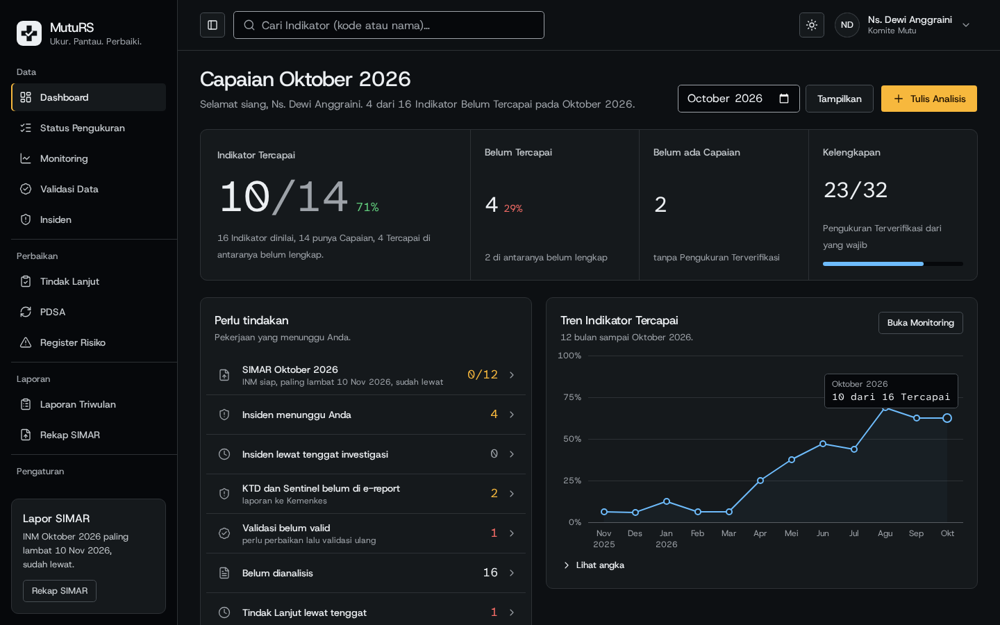
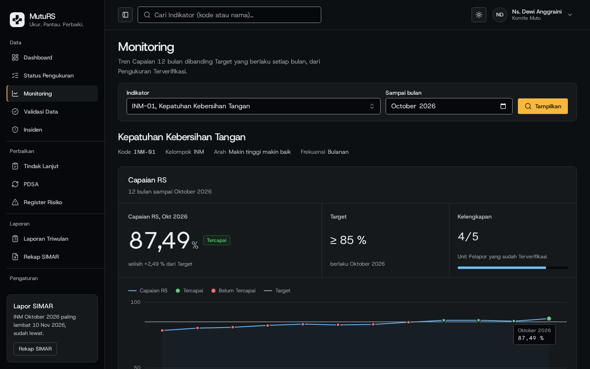
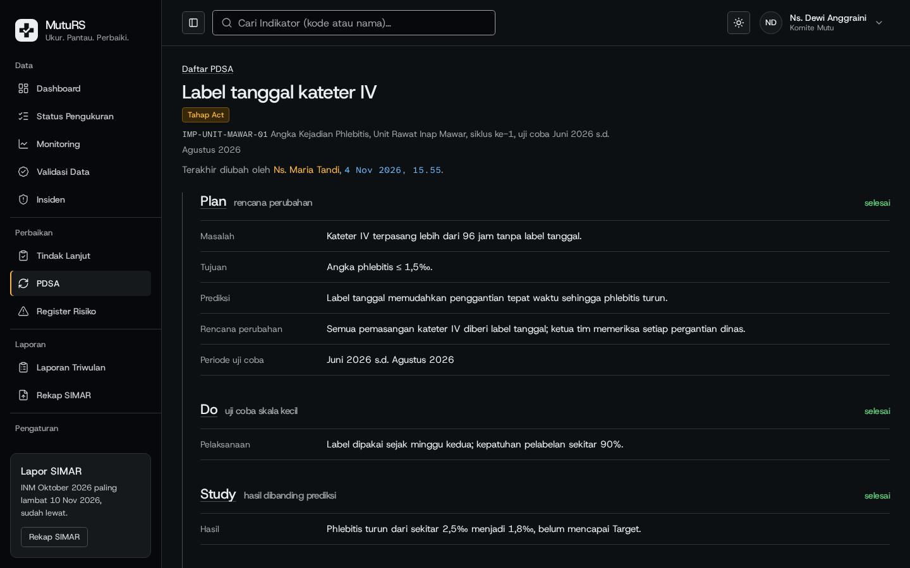
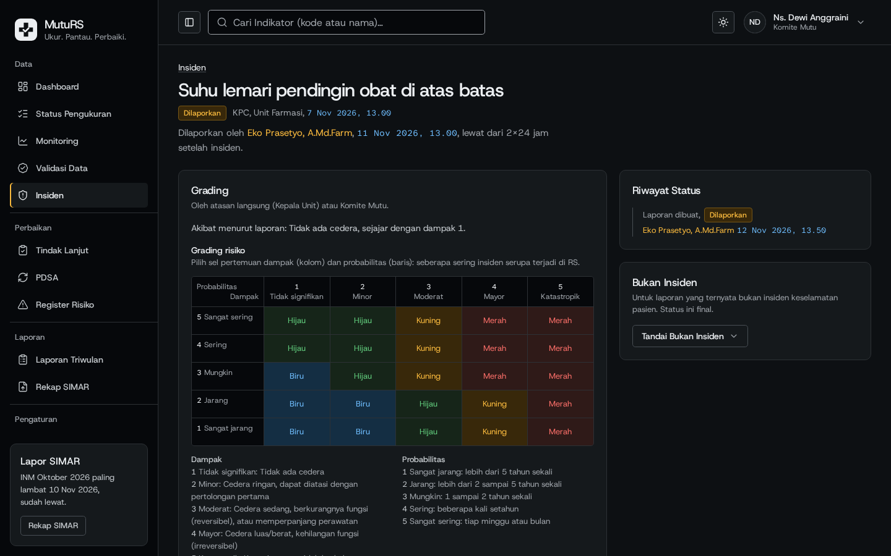

# MutuRS

**Ukur. Pantau. Perbaiki.** MutuRS adalah aplikasi web untuk mengelola indikator mutu dan keselamatan pasien di rumah sakit Indonesia. Pengguna utamanya Komite Mutu, Kepala Unit, dan petugas ruangan. Siklusnya utuh: data N/D diisi per Unit, diverifikasi, dihitung menjadi Capaian, dianalisis, diperbaiki lewat Tindak Lanjut dan PDSA, lalu dilaporkan ke Direktur, Dewan Pengawas, dan SIMAR Kemenkes.

MutuRS dipasang di server RS sendiri (docker compose) dan tetap berjalan tanpa internet.



## Masalah yang diselesaikan

Di banyak rumah sakit, data mutu masih hidup di lembar Excel dan kertas per ruangan:

- **Angka tersebar dan tidak seragam.** Setiap ruangan punya berkas sendiri, Target berubah tanpa riwayat, dan Komite Mutu merekap manual setiap bulan.
- **Rekap rawan salah.** Capaian RS sering dihitung sebagai rata-rata persentase ruangan, padahal yang benar adalah ΣN/ΣD. Data yang belum diperiksa Kepala Unit ikut terhitung.
- **Bukti akreditasi tercecer.** Surveior PMKP meminta analisis, PDSA, validasi data, laporan triwulan, umpan balik Dewan Pengawas, analisis efisiensi, investigasi insiden, dan register risiko. Semuanya ada di folder yang berbeda-beda.
- **Tenggat terlewat.** Batas SIMAR tanggal 10, investigasi insiden 7, 14, atau 45 hari, dan tenggat Tindak Lanjut tidak ada yang mengingatkan.
- **Server RS tidak ideal.** Listrik sering padam, internet tidak selalu ada, dan IT RS butuh backup serta pemulihan yang sederhana.

## Fitur: masalah dan penanganannya

### Indikator dan Target

**Masalah:** definisi indikator, Target, dan ruangan pelapornya berubah tanpa jejak, sehingga angka bulan lalu ikut berubah.

- 13 **INM** sesuai PMK 30/2022 sudah tersedia. Indikator bisa ditambah untuk kelompok **IMP-RS**, **IMP-Unit**, dan **SPM**: definisi operasional, numerator, denominator, faktor, arah (makin tinggi atau makin rendah makin baik), serta frekuensi bulanan atau semesteran.
- **Target berlaku mulai bulan tertentu.** Bulan sebelumnya tetap dinilai dengan Target lamanya.
- **Unit Pelapor per periode** (bulan mulai sampai bulan berhenti). Ruangan yang pindah atau tutup tidak merusak data lama. IMP-Unit hanya boleh punya satu Unit Pelapor pada bulan yang sama.
- **Cara hitung terkunci** setelah ada Pengukuran, supaya angka lama tidak berubah makna.

### Pengukuran dan Verifikasi

**Masalah:** angka masuk tanpa pemeriksaan dan tanpa bukti asalnya.

- Petugas Input Data mengisi **N dan D per Unit per bulan**. Pratinjau Capaian tampil langsung saat mengisi.
- **Bukti** (foto atau PDF, paling banyak 5 berkas, masing-masing paling besar 10 MB) dilampirkan ke Pengukuran dan disimpan di database, sehingga ikut backup.
- Alurnya **Draf → Diajukan → Terverifikasi**. Kepala Unit memverifikasi, mengembalikan dengan alasan, atau membuka kembali. Setiap perpindahan status tercatat di Riwayat Status.
- Halaman **Status Pengukuran** menampilkan Unit yang belum mengisi pada bulan itu.

### Capaian, Dashboard, dan Monitoring

**Masalah:** rekap manual lambat dan rumusnya berbeda-beda.

- **Capaian RS = ΣN/ΣD** dari Pengukuran Terverifikasi, bukan rata-rata Capaian ruangan. Satu rumus dipakai di semua halaman.
- **Kelengkapan** menunjukkan berapa Unit Pelapor yang sudah Terverifikasi, sehingga angka yang belum lengkap terlihat jelas.
- **Dashboard per peran.** Isinya Capaian bulan lalu dan antrean "Perlu tindakan": Verifikasi, SIMAR, Insiden, Tindak Lanjut lewat tenggat, validasi belum valid, dan Indikator belum dianalisis.
- **Monitoring** menampilkan tren 12 bulan per Indikator dibanding Target yang berlaku setiap bulan, untuk RS dan per Unit. Setiap grafik selalu disertai tabel angkanya.



### Perbaikan: Analisis, Tindak Lanjut, PDSA

**Masalah:** Capaian yang belum tercapai berhenti sebagai angka, tanpa analisis dan tanpa bukti perbaikan.

- **Analisis** per Indikator, per bulan, untuk Lingkup RS atau Lingkup Unit.
- **Tindak Lanjut** dengan penanggung jawab dan tenggat. Yang lewat atau mendekati tenggat (7 hari) ditandai.
- **PDSA** (Plan, Do, Study, Act) dengan siklus berikutnya. Grafik tahap Study diambil langsung dari data Capaian, bukan dari tempelan gambar.
- **Analisis Efisiensi** (PMKP 4 g) mencatat biaya per jenis sumber daya sebelum dan sesudah perbaikan.



### Validasi Data (PMKP 5)

**Masalah:** validasi dilakukan tanpa aturan sampel yang jelas, dan hasil tidak valid tidak ditindaklanjuti.

- Sampel minimal validator dihitung menurut **Tabel 3 PMK 30/2022**. Kesesuaian dihitung otomatis, dan data valid bila kesesuaian ≥ 90%.
- Hasil tidak valid wajib disertai penyebab dan perbaikan, lalu divalidasi ulang. Status "belum valid" tampil di Dashboard dan Laporan Triwulan.

### Pelaporan

**Masalah:** laporan triwulan dan isian SIMAR disusun ulang dari nol setiap periode.

- **Laporan Triwulan** untuk Direktur dan Dewan Pengawas: Capaian, Analisis, PDSA, validasi, rekap insiden, dan rekomendasi Komite Mutu. Bisa dicetak A4 dari browser atau diunduh sebagai CSV.
- **Umpan Balik Dewan Pengawas** (TKRS 1): umpan balik atas laporan dan evaluasi tindak lanjutnya pada pertemuan berikutnya.
- **Rekap SIMAR**: N, D, "Analisa Capaian", dan "Rencana Tindak Lanjut" untuk setiap INM, siap disalin ke SIMAR Kemenkes. Isian yang belum siap ditandai, dan tenggat tanggal 10 diingatkan.
- **Rekap Bulanan** dalam bentuk CSV untuk diolah di Excel. CSV memakai pemisah `;` dan koma desimal, sesuai Excel berbahasa Indonesia.

### Insiden Keselamatan Pasien

**Masalah:** laporan insiden lewat kertas, grading tidak seragam, dan tenggat investigasi terlewat.

- **Semua Pengguna bisa melapor** dengan isian Formulir 1 PMK 11/2017 (KPC, KNC, KTC, KTD, Kejadian Sentinel).
- **Grading** memakai matriks dampak × probabilitas Pedoman KKP-RS: Biru, Hijau, Kuning, Merah.
- **Tenggat dihitung otomatis:**
  - Investigasi Sederhana: 7 hari untuk Biru, 14 hari untuk Hijau;
  - RCA: 45 hari untuk Kuning, Merah, dan semua Kejadian Sentinel.
- Tanggal e-report ke Kemenkes dicatat untuk KTD dan Sentinel.
- **Akses dibatasi.** Identitas pasien hanya dibaca Pembuat Laporan, Kepala Unit tempat insiden, Komite Mutu, dan Direktur. Rekap di Laporan Triwulan tanpa identitas.



### Register Risiko

**Masalah:** register risiko unit diisi di lembar terpisah, dan simpulan "ada penurunan" bisa bertentangan dengan angkanya sendiri.

- Register per Unit per tahun:
  - Kategori Risiko;
  - **Penilaian Awal** (Probabilitas × Dampak → Nilai Risiko, Bobot, Tingkat, Prioritas);
  - Perlakuan dan jadwalnya;
  - **Hasil Pemantauan**;
  - Simpulan;
  - Dokumen Review (PDF, DOC, DOCX).
- Simpulan penurunan Tingkat Risiko dihitung dari angkanya. Efektivitas Perlakuan dinilai setelah pemantauan.

### Akuntabilitas dan keamanan

- **Lima peran** dengan hak akses yang diperiksa di lapisan service, bukan hanya disembunyikan di tampilan.
- **Jejak Audit** mencatat siapa mengubah data apa dan kapan, termasuk percobaan masuk yang gagal. Isinya tidak memuat sandi, isi berkas, atau identitas pasien.
- **Pembatasan percobaan masuk.** Sandi disimpan dengan bcrypt.
- **Berkas unggahan diperiksa dari isinya**, bukan dari nama atau ekstensinya, lalu dibuka dengan header `Content-Security-Policy: sandbox`.

### Pemasangan di rumah sakit

- **Satu perintah:** `docker compose up -d --build` menjalankan aplikasi, PostgreSQL 17, dan layanan backup.
- **Tanpa internet.** Font disimpan lokal, tidak ada CDN, dan tidak ada layanan luar.
- **Backup harian** pukul 01.00 waktu setempat, disimpan 30 hari. Langkah pemulihan dan penanganan listrik padam ada di [INSTALASI.md](INSTALASI.md).
- **Migrasi database otomatis** saat aplikasi mulai.
- **Bisa dipakai di HP** (lebar 390 px), dengan mode gelap dan terang.

## Peran pengguna

| Peran | Tugas utama |
|---|---|
| Petugas Input Data | Mengisi Pengukuran Unit-nya dan melampirkan Bukti; mengisi Register Risiko Unit-nya; melapor Insiden. |
| Kepala Unit | Memverifikasi Pengukuran; menulis Analisis, Tindak Lanjut, dan PDSA untuk Unit-nya; grading dan Investigasi Sederhana Insiden Unit-nya. |
| Komite Mutu | Mengelola Indikator, Target, dan Unit Pelapor; memantau seluruh RS; menyusun Laporan Triwulan dan Rekap SIMAR; bertindak sebagai Tim Keselamatan Pasien (tinjauan, RCA). |
| Direktur | Membaca Capaian, laporan, dan insiden seluruh RS; mencatat umpan balik Dewan Pengawas. |
| Admin Sistem | Mengelola Pengguna dan Unit; membaca Jejak Audit; menghapus Insiden, Risiko, dan PDSA yang salah dimasukkan. |

## Rujukan regulasi

Aturan di MutuRS diambil dari dokumen resmi, dan setiap aturan dicatat sumber serta halamannya di [`docs/research/`](docs/research):

- PMK No. 30 Tahun 2022 (Indikator Nasional Mutu, validasi data);
- PMK No. 11 Tahun 2017 dan PP No. 28 Tahun 2024 (Keselamatan Pasien);
- KMK HK.01.07/MENKES/1596/2024 (Standar Akreditasi Rumah Sakit: PMKP, TKRS);
- Pedoman Pelaporan IKP KKP-RS 2008 (matriks grading).

MutuRS membantu menyusun bukti. Kesesuaian dengan standar tetap menjadi tanggung jawab rumah sakit, dan regulasi bisa berubah.

## Memasang

Kebutuhan: server Linux dengan Docker dan plugin compose.

```bash
git clone <url-repo> mutu-rs && cd mutu-rs
cp .env.example .env
nano .env        # isi NAMA_RS, ganti POSTGRES_PASSWORD dan ADMIN_PASSWORD
docker compose up -d --build
```

Buka `http://<ip-server>:<APP_PORT>`, lalu masuk dengan `ADMIN_USERNAME` dan `ADMIN_PASSWORD` dari `.env`. Penjelasan setiap variabel ada di [`.env.example`](.env.example). Pembaruan versi, backup, dan pemulihan ada di [INSTALASI.md](INSTALASI.md).

## Pengembangan

Kebutuhan: Node.js 24 dan Docker (untuk PostgreSQL).

```bash
# Database dev
docker run -d --name mutu-rs-db -p 127.0.0.1:55434:5432 \
  -e POSTGRES_USER=mutu -e POSTGRES_PASSWORD=mutu -e POSTGRES_DB=mutu postgres:17-alpine

npm ci
cp .env.example .env
npx next dev -p 3000

# Opsional: data contoh 12 bulan (Pengguna per peran bersandi mutu12345, mis. komite, kepala.igd, petugas.igd)
npx tsx --env-file=.env scripts/data-dummy.ts
```

Buka lewat `http://localhost:3000`, bukan `127.0.0.1`, karena dev server memblokir JavaScript-nya bila dibuka dari alamat lain.

| Perintah | Kegunaan |
|---|---|
| `npm test` | Tes service di database PostgreSQL sementara, yang dihapus setelah selesai. Satu berkas: `npm test -- tests/<nama>.test.ts`. |
| `npm run check` | Typecheck + lint + semua tes. Wajib lolos sebelum mengirim perubahan. |
| `npm run db:generate -- --name <slug>` | Membuat migrasi setelah mengubah `src/db/schema.ts`. |

**Teknologi:**
- Next.js 16 (App Router, server actions), React 19, TypeScript;
- Drizzle ORM + PostgreSQL 17;
- Tailwind CSS 4 + shadcn/ui (Radix), ikon lucide;
- tes `node:test` lewat `tsx` terhadap database sungguhan.

### Struktur kode

```
src/app/            halaman (server component) + server action tipis + route unduhan
src/modules/*/      logika bisnis per modul (service.ts): validasi, hak akses, transaksi, Jejak Audit
src/lib/            aturan murni bersama: rumus Capaian, bulan dan triwulan, grading, matriks risiko, CSV
src/db/             skema Drizzle dan bootstrap (migrasi + data awal INM)
drizzle/            migrasi SQL
tests/              tes perilaku per modul, memanggil service sebagai Pengguna sungguhan
scripts/            uji, backup, data contoh, impor dari aplikasi mutu lama
docs/               riset regulasi (research/), keputusan arsitektur (adr/), tangkapan layar
```

### Dokumen proyek

- [`GLOSSARY.md`](GLOSSARY.md): istilah domain. Kode, tampilan, dan dokumen hanya memakai istilah ini, tanpa sinonim.
- [`design.md`](design.md): sistem desain tampilan.
- [`docs/adr/`](docs/adr): keputusan arsitektur.
- [`docs/research/`](docs/research): ringkasan regulasi beserta sumber dan halamannya.
- `.scratch/<fitur>/`: spec dan laporan setiap rilis, termasuk keputusan yang diambil.

## Berkontribusi

- Tampilan, pesan error, dan komentar kode memakai **Bahasa Indonesia**. Nama domain di kode memakai istilah glosarium (`indikator`, `unitPelapor`, `pengukuran`, `capaian`).
- **Aturan bisnis dan hak akses** ditulis di `src/modules/<modul>/service.ts`, bukan di halaman. Setiap perubahan data dicatat ke Jejak Audit dalam transaksi yang sama.
- Setiap perilaku baru disertai tes di `tests/`. Jalankan `npm run check` sebelum mengirim pull request.
- Laporkan bug dan usulan fitur lewat issue. Sertakan peran pengguna, langkah, dan hasil yang diharapkan.

## Lisensi

Copyright (C) 2026 mmuhdar

MutuRS adalah perangkat lunak bebas di bawah [GNU Affero General Public License](LICENSE) versi 3, atau (sesuai pilihan Anda) versi yang lebih baru (`AGPL-3.0-or-later`).

Ringkasnya:
- MutuRS boleh dipakai, dipelajari, diubah, dan disebarkan, termasuk oleh vendor dan untuk keperluan komersial.
- Versi yang diubah harus dirilis dengan lisensi yang sama.
- Bila versi yang diubah dijalankan untuk dipakai orang lain lewat jaringan, misalnya dipasang di rumah sakit lain atau disewakan sebagai layanan, kode sumbernya wajib ditawarkan kepada penggunanya (Pasal 13).
- MutuRS diberikan tanpa jaminan apa pun.

Ringkasan ini bukan pengganti teks lisensi. Yang berlaku adalah isi [LICENSE](LICENSE).
